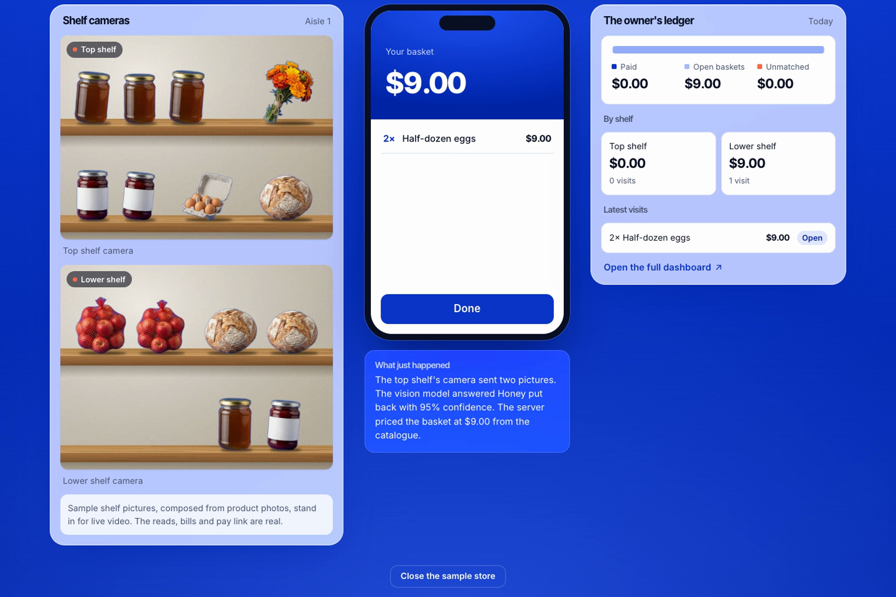
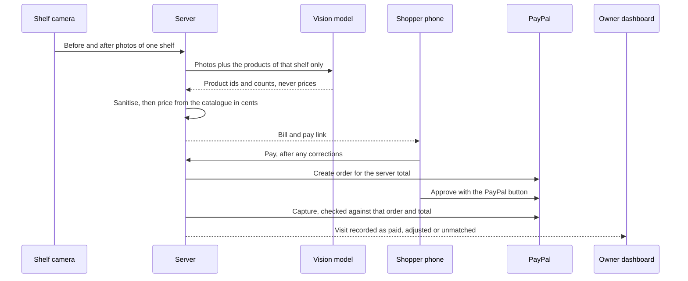
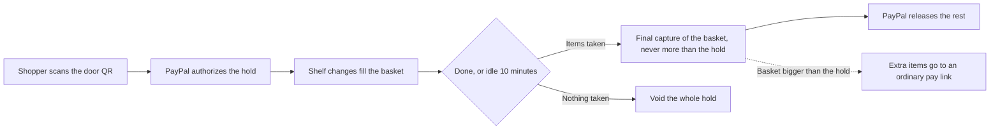
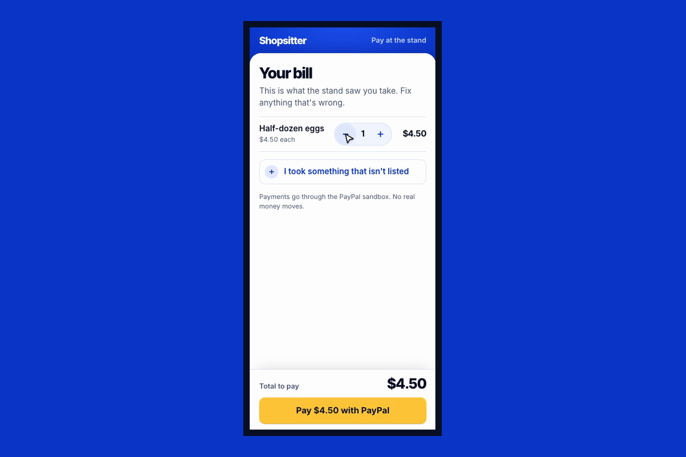
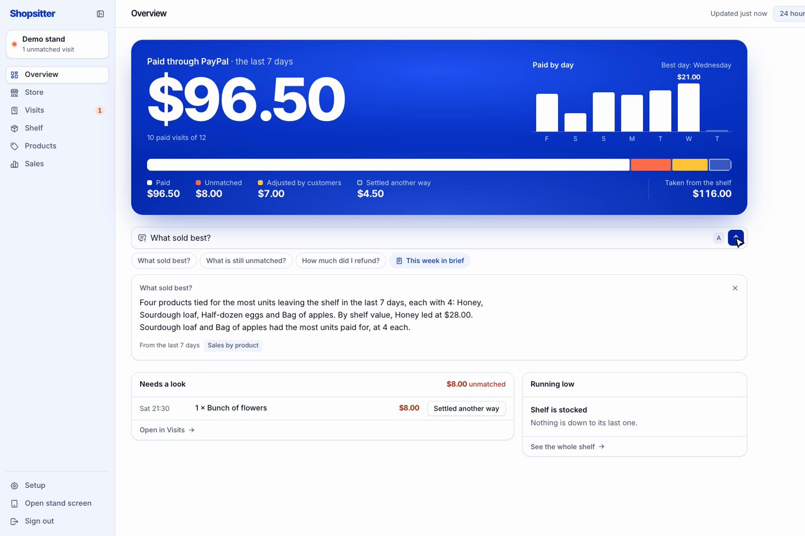
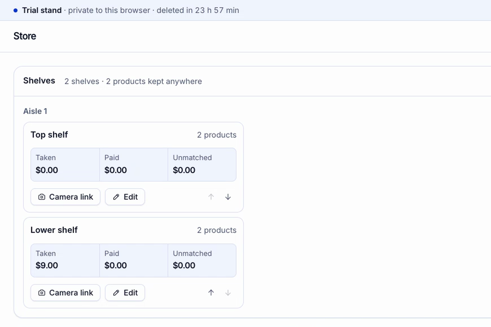

# Shopsitter

**Walk-out checkout for any shop, from a market stall to a supermarket aisle, using the cameras it already has, and
PayPal for the money.** Phones, webcams or existing CCTV cameras watch the shelves, a vision model says what left,
the server prices it, PayPal takes the payment, and the owner sees every sale on a dashboard.

[](https://shopsitter.vercel.app)
[](#tested)
[](LICENSE)


<sub>The store simulator at /demo/store: the shelf cameras, the shopper's basket and the owner's ledger, all on the real routes.</sub>

Built for the PayPal AI Hackathon 2026. PayPal runs in sandbox mode: no real money moves.

## Try it in 30 seconds

| What | Link | What you will see |
| --- | --- | --- |
| Watch a whole store run | [/demo/store](https://shopsitter.vercel.app/demo/store) | Take items off two shelves; the vision model reads them, the basket fills, the ledger moves. One click, no sign-in. |
| Run your own shop | [/demo](https://shopsitter.vercel.app/demo), "Start my stand" | A private trial store: your products, your phone or laptop camera, a real sandbox payment. Deleted after 24 hours. |
| Example dashboard | [/owner/login](https://shopsitter.vercel.app/owner/login), passcode `demo` | A week of example visits, read-only |

To pay a bill, use a sandbox buyer account from your own PayPal developer dashboard.

**Demo video:** [watch on YouTube (2:44)](https://youtu.be/iL1XZy0ASIU)

## The problem

Checkout is the problem at every size of shop: a queue at the supermarket, a cash tin and a sign at the farm stand.
Walk-out stores exist, but they need hundreds of cameras and shelf sensors, which most shops cannot afford.
Shopsitter needs one camera per shelf (a phone will do, or a CCTV camera already on the wall) and a PayPal account.
Start with one shelf and add shelves and aisles as you grow; a bigger store can start with one aisle or a grab-and-go
section. Any shop can be a walk-out shop.

## How it works

1. **The camera notices a change.** The camera page compares small grayscale frames, waits for the shelf to go
   still (and for any hand to leave), then sends a before and an after photo of that shelf.
2. **The vision model says what left.** It sees only the products on that shelf, with their reference photos, and
   returns product ids and counts. Negative counts are items put back.
3. **The server prices it.** Model output is sanitised, then priced from the owner's catalogue in whole cents.
4. **The shopper pays with PayPal.** Either pay after (a QR on the shelf screen opens the bill, which the shopper
   can correct) or hold first (scan the door QR, PayPal holds an amount, the basket fills on the phone, Done or
   walk away to be charged for what was taken).
5. **The owner sees it.** Paid, adjusted, unmatched and refunded, per shelf, with before and after photos.



**The hold path.** The hold covers nine in ten paid baskets at this shop over the last 30 days, rounded up to the
next $5 and kept within the owner's minimum and maximum (`lib/hold.ts`).



## How PayPal is used

| PayPal product or API | What it does here | Where in the code |
| --- | --- | --- |
| Orders v2: create order (intent CAPTURE) | Every bill becomes an itemised order for the total the server computed | `lib/paypal.ts` (`buildOrderBody`), `lib/checkout.ts` (`startOrder`) |
| Orders v2: capture order | Captures only the order created for that bill, and only if the total still matches | `lib/checkout.ts` (`captureVisit`) |
| Orders v2: create order (intent AUTHORIZE) + authorize | Puts the hold on the shopper's PayPal before they shop | `lib/paypal.ts` (`buildHoldOrderBody`, `authorizeOrder`), `lib/sessions.ts` (`authorizeHold`) |
| Payments v2: capture authorization | One final capture of the basket total, never more than was held | `lib/sessions.ts` (`finishSession`), `lib/paypal.ts` (`captureAuthorization`) |
| Payments v2: void authorization | Releases a hold when nothing was taken, when the owner settles the visit another way, or when a trial store ends | `lib/sessions.ts`, `lib/owner.ts`, `lib/trials.ts` |
| Payments v2: refund capture | Full or partial refunds from the owner's visit page | `lib/owner.ts`, `lib/paypal.ts` (`refundCapture`) |
| `PayPal-Request-Id` idempotency keys, timeouts | Every write carries a key, so a retry cannot charge twice; calls time out after 15 s | `lib/paypal.ts` |
| JavaScript SDK v6 (`@paypal/react-paypal-js/sdk-v6`) | The pay button on the bill and the hold step in the basket | `components/PayPanel.tsx`, `components/basket/Basket.tsx` |
| Agent Toolkit (`@paypal/agent-toolkit`), read-only | Lets "Ask your shop" look up a PayPal order or the account's transactions, with an 8 s timeout; trial stores get no lookups and the demo store sees only its own orders | `lib/paypal-read.ts` |

Server calls use `@paypal/paypal-server-sdk`. A capture PayPal accepted but the app could not record still keeps the
capture reference, and the shopper is told to check PayPal rather than "nothing was charged".

## How AI is used

| Model | Input | Output and guard rails | Where |
| --- | --- | --- | --- |
| Vision model (reads the shelf) | Before and after photos, the products of that one shelf with reference photos, a close-up of the changed area, and photos from extra cameras when present | Product ids and whole counts (negative for put-backs) plus a confidence. A sanitiser keeps only that shelf's catalogue ids and whole quantities up to 20. It is never asked for a price, and is told not to follow instructions inside the catalogue or photos. 25 s timeout. | `lib/vision.ts`, `lib/stand.ts` |
| Language model ("Ask your shop") | The owner's question and tools that return server-computed facts (totals, visits, top sellers, stock, unmatched, refunds, PayPal lookups) | A written answer. Any answer with an amount not found in the facts, or that accuses someone, is replaced by the facts themselves. | `lib/ask.ts`, `lib/ask-model.ts` |
| On-device hand and person detection (MediaPipe) | The camera picture, in the camera phone's browser | Holds the shelf read while a hand is in view and counts people who stopped by. Nothing about a person is stored or sent; only a daily count is kept. | `components/people-detector.ts`, `lib/presence.ts`, `lib/footfall.ts` |

**Measured accuracy:** 15 of 15 reads exactly right on seven sample shelf pairs (taken, two alike, two kinds, slid,
light change, taken and shifted, put back). The pairs are composed pictures, which are easier than real photos;
nothing has been measured on photos of a real shelf yet. Details: [docs/accuracy.md](docs/accuracy.md).

## What makes it different

- **Cameras you already have.** A phone, a USB webcam, or an existing CCTV or IP camera through the
  [camera bridge](bridge/README.md). Only the shelf rectangle leaves the building.
- **Built to grow shelf by shelf.** Each shelf has its own camera and product list, grouped by aisle, so a shop adds
  one shelf at a time instead of fitting out the whole floor at once.
- **The model only chooses among one shelf's products.** A store can stock many products while each read stays a
  small choice, and the model never sets a price.
- **Nobody is identified or accused.** A visit nobody paid for is "unmatched". With several shoppers checked in, a
  change shows on their phones and the shopper who took it claims it.
- **A hold sized from real spend,** not a fixed deposit, captured for exactly what was taken.
- **A whole store anyone can run in one click.** [/demo/store](https://shopsitter.vercel.app/demo/store) builds a
  private trial store with two shelves and drives the real routes, model and ledger.

## Features

**Shopper.** No app or account. Pay after from the shelf QR, or scan the door QR for a live basket with a PayPal
hold. Correct a wrong bill before paying. Put an item back and it comes off the bill. Claim a shelf change that was
yours when several people are shopping.


<sub>The bill a shopper sees: what the camera saw, editable, paid with PayPal.</sub>

**Owner.** Overview of money paid through PayPal and where the shelf value went. Visits with before and after
photos, refunds, and "settled another way". Shelf levels and restocking. A product editor with reference photos.
A store map of aisles and shelves with a camera link per shelf and a door QR that can be reissued. Pay mode: pay
after, hold, or shopper's choice, with hold minimum, maximum or a fixed amount. Charts on the Sales page. The
"Ask your shop" box.


<sub>The owner overview on the example week, with an answer from "Ask your shop".</sub>

**Cameras.** One camera per shelf, from the shelf's camera link. Up to three extra cameras can watch the same shelf
from other sides (`/stand/camera/2` to `4`). The CCTV bridge (`npm run bridge -- shelf.json`, needs ffmpeg) runs
the same change detector and posts to the same route.


<sub>The store map: shelves grouped by aisle, each with its own camera link and figures.</sub>

## Sponsor tools

**AG Studio** (`ag-studio`, `ag-studio-react`) draws the owner's Sales page: three data sources built from visits,
the items in them and stock, a ready-made "Sales" page of charts on first load, and a board the owner can rearrange
or add to. Themed in the app's colours. Code: `components/owner/SalesStudio.tsx`, `lib/studio-report.ts`. It runs on
the trial licence, which prints a notice in the browser console.

## Architecture

One Next.js 16 app on Vercel. Browsers do the camera work; the server owns every price and every PayPal call;
storage sits behind one interface with a file back end (development) and Postgres (hosted). Route handlers validate
input, identify the caller and rate-limit, then call one function in `lib/` with its dependencies passed in.
Full picture, request flows, data model and visit states: [docs/architecture.md](docs/architecture.md).
All documents: [docs/README.md](docs/README.md).

## Security

- Prices and totals are computed on the server only; browsers and the model send ids and counts.
- Every PayPal write is idempotent; a capture must match the order and total the server created.
- Each store is taken from a verified cookie, stand code, signed key or door token, never from the request body.
- Camera codes are rate limited before comparison; trial and demo model reads have caps across all callers.
- Shelf photos are visible only to that store's signed-in owner; nothing about a person is stored.

Who can do what, every token, and the known limits: [docs/security.md](docs/security.md).

## Tested

591 unit tests pass (`npm test`, Vitest), with a fake PayPal gateway; the storage contract suite runs on the file
back end and, when `DATABASE_URL` is set, on Postgres. Independent security and QA reviews covered routes, tokens,
rate limits, store separation, money paths and the UI at phone and desktop widths; findings were fixed or listed as limits.

## Run it yourself

Requirements: Node 22 or newer, a PayPal sandbox app (client id and secret), and a key for the model provider.

```bash
git clone https://github.com/MaanavKrishna/ShopSitter.git
cd ShopSitter
npm install
cp .env.example .env.local   # then fill in the values
npm run dev                  # http://localhost:3210
```

| Name | What it is |
| --- | --- |
| `PAYPAL_CLIENT_ID`, `PAYPAL_CLIENT_SECRET` | Your own PayPal sandbox app |
| `ANTHROPIC_API_KEY` | Key for the vision and language models (read by the model SDK) |
| `VISION_MODEL`, `ASK_MODEL` | Model ids (defaults are in `.env.example`) |
| `OWNER_PASSCODE` | Passcode for your shop's dashboard |
| `DEMO_PASSCODE` | Passcode for the demo shop (`demo`) |
| `STAND_TOKEN` | 6-digit code your shelf cameras ask for |
| `SESSION_SECRET` | A long random string; signs cookies, camera keys and door codes |
| `REPO` | `file` (local `.data/` folder) or `postgres` (also set `DATABASE_URL`) |

```bash
npx tsx --env-file=.env.local scripts/seed.ts demo --examples   # example week for the demo shop
npm test                                                        # unit tests
npm run lint
```

Sign in at `/owner/login`, add products at `/owner/products`, add shelves and print the QR codes at `/owner/store`,
and open each shelf's camera link on a phone. Phone cameras need https: deploy it, or run
`npx next dev --experimental-https`. For CCTV or a video file, see [bridge/README.md](bridge/README.md).

## Project structure

```
app/          Pages and API routes (public site, demo, stand, pay, basket, owner dashboard)
bridge/       Camera bridge for CCTV, IP cameras, webcams and video files
components/   React components by area (stand, pay, basket, owner, simulator, site)
docs/         Architecture, security, accuracy, images
lib/          Server logic: shelf reads, visits, checkout, sessions and holds, PayPal, storage
public/       Product photos and sample shelf pictures
scripts/      Seeding and the accuracy evaluation
tests/        Vitest unit and storage contract tests
themes/       Component theme
```

## Limits

- Proven on a small sample store. The design scales shelf by shelf, and a larger store could start with one aisle,
  but a full supermarket (thousands of products, crowds, staff restocking mid-visit) has not been tried and would
  need the work listed in the roadmap. Products on a shelf should look different from each other, and the light
  should be reasonable.
- Accuracy is measured only on composed sample pictures. The CCTV bridge has been proven with a video file, not
  yet with a real CCTV stream.
- Several shoppers at once rely on people claiming their own items.
- Rate limits are counted per server instance. PayPal runs in sandbox mode only. Full list in
  [docs/security.md](docs/security.md#known-limits-of-this-prototype).

## Roadmap

- Larger stores, one aisle first: try a single aisle or grab-and-go section of a bigger shop on its existing CCTV.
- A rectangle editor for drawing shelves on a CCTV picture, so one CCTV camera can cover several shelves without
  editing `shelf.json`.
- Handling staff restocking, so a shelf being refilled is not read as a shopper's visit.
- Product catalogues in the hundreds per aisle, with reads that stay accurate as each shelf's list grows.
- Saved PayPal approvals for regulars, so they can walk in and out without a hold step.
- Learning from bills shoppers corrected, to improve reads for each shop.
- Several shops per owner.

## Licence

MIT. See [LICENSE](LICENSE).
